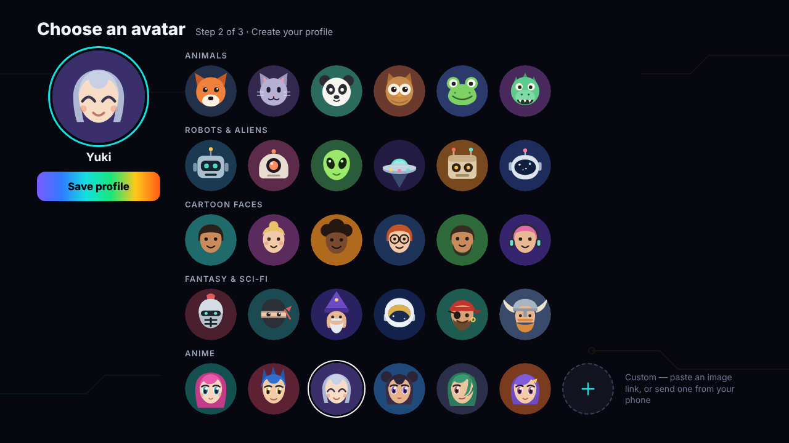
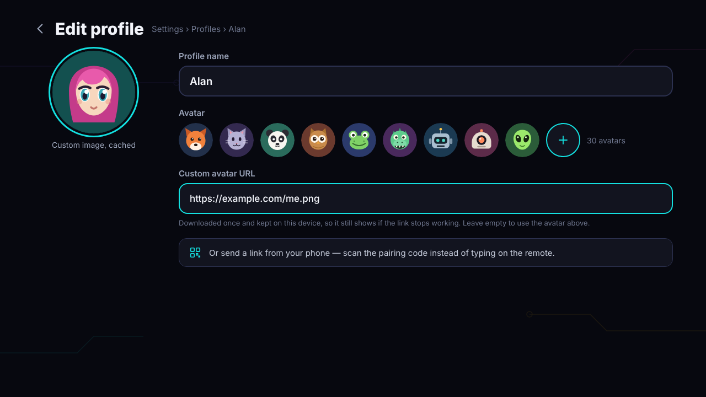

# VantaView: design mockups

Signed-off design mockups for **VantaView**, an IPTV & VOD player for Android phones, tablets, Android TV and Fire TV.

Open `index.html` in a browser to browse every screen, or open any file under `mockups/` on its own. TV screens are 1280×720 and phone screens are 390×844. All names, titles and channels shown are placeholders.

## Home

**Home – TV**  

**New season message – TV**  

**Home – Phone**  

## Live TV & EPG

**Live TV channels – TV**  

**TV Guide timeline – TV**  

**Live TV – Phone**  

## Sports

**Sports – TV**  

**Sports – Phone**  

**Event details – TV**  

**Event details – Phone**  

## Movies

**Movies – TV**  

**Movies – Phone**  

## TV Series

**TV Series – TV**  

**TV Series – Phone**  

## Movie details

**Movie details – TV**  

**More menu & Choose source – TV**  

**Movie details – Phone**  

**Actor page (Available tab) – TV**  

**Actor page (All tab) – Phone**  

**Share to a profile – TV**  

## Series details

**Series details – TV**  

**Seasons & episodes (scrolled down) – TV**  

**Series details – Phone**  

## Library

**Library · Shared with you – TV**  

**Shared message on opening – TV**  

**Library – Phone**  

## Player

**Live TV player (paused, behind live) – TV**  

**Quick channel list – TV**  

**Series player with Skip intro – TV**  

**Next episode countdown – TV**  

**Movie player – Phone (landscape)**  

## Settings

**Settings · Live buffer – TV**  

**Settings · Accent colour – TV**  

**Settings list – Phone**  

**Settings · Trailers – Phone**  

**Settings list (scrolled down) – Phone**  

**Settings · Free channels – TV**  

**Settings · Credits – TV**  

## Add Playlist

**Add Playlist · Smart Add – TV**  

**Add Playlist · From phone (QR) – TV**  

**Free channels · pick countries – TV**  

**Add Playlist · Smart Add result – Phone**  

## Profiles

**First launch · Create your profile – TV**  

**Choose profile – TV**  

**Add another profile – Phone**  

**Choose an avatar – TV**  

**Edit profile · custom avatar – TV**  

## Search, Terms, Splash & Drawer

**Search – TV**  

**Terms of use (first launch) – TV**  

**Splash screen – TV**  

**Menu drawer – Phone**  

**Search – Phone**  

## Reddit additions

**Catch-up (TV)**  

**Catch-up (Phone)**  

**Live TV guide · past programme and full description (TV)**  

**Player · channel up/down on the remote (TV)**  

**Movies · info on focus (TV, same for TV Series)**  

**Sports · My teams and leagues (TV)**  

**Sports · Follow teams (Phone)**  

**Home · weather by the clock and 5-day forecast (TV)**  

**Settings · Sync watch progress with Trakt (TV)**  

**Add Playlist · Jellyfin server, after launch (TV)**  

## Avatars

30 original avatars for the profile picker, in five groups — Animals, Robots & aliens, Cartoon faces, Fantasy & sci-fi and Anime — plus a Custom tile where the user supplies their own image by URL. SVG sources are in [`avatars/`](avatars), named `avatar_<group>_<name>.svg`.

## Credits

- Free channels list: [Free TV](https://github.com/Free-TV/IPTV), an M3U playlist of free TV channels around the world. Thanks to its maintainers and contributors.
- Movie and TV information: The Movie Database (TMDB). This product uses the TMDB API but is not endorsed or certified by TMDB.
- Sports fixtures and results: [TheSportsDB](https://www.thesportsdb.com).
- Weather: [Open-Meteo](https://open-meteo.com) (CC BY 4.0).
